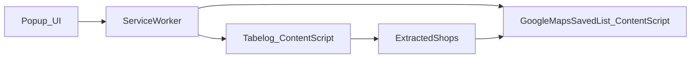

# Chrome Extension Decision Checklist

Inventory of product and engineering decisions for the Manifest V3 + TypeScript extension. Normative accepted choices live in ADRs; this page tracks status and pointers.

## Accepted (do not re-litigate without a new ADR)

| Topic | Decision | Source |
| :--- | :--- | :--- |
| Delivery form | Desktop Chrome Manifest V3 extension, TypeScript → bundled JS | [ADR-0003](adr/0003-chrome-extension-my-maps-web-import.md) |
| Extract source | PC saved-list DOM only (fixed selectors) | [ADR-0003](adr/0003-chrome-extension-my-maps-web-import.md), [extraction spec](../reference/tabelog-pc-saved-list-extraction-spec.md) |
| Fields | name, address, URL; optional short description; URL first line of description; **collections** (`id` + `name`, may be empty) | extraction spec, [ADR-0005](adr/0005-extract-collections-for-future-pin-styling.md) |
| Import path | Google Maps native saved-list automation — ensure `食べログ` list exists, dedupe-check by name, search-by-name+address, add-or-skip each shop. **Implemented and live-verified** (English locale; a 42-shop run added/skipped correctly). My Maps / KML code has been deleted from this repository. | [ADR-0008](adr/0008-google-maps-saved-list-import.md) |
| Privacy | User-started only; no credentials, cookies, profile reads; bookmarks JSON allowlists `labels` only | [ADR-0003](adr/0003-chrome-extension-my-maps-web-import.md), [ADR-0005](adr/0005-extract-collections-for-future-pin-styling.md) |
| Failure | Selector/UI/count mismatch → explicit failure; no fake full success | [ADR-0003](adr/0003-chrome-extension-my-maps-web-import.md) |
| Permissions & injection | See ADR-0004 | [ADR-0004](adr/0004-extension-implementation-baseline.md) |
| UX flow & tab premise | Popup-only extract; complete → Next → confirm summary → Import start | [ADR-0004](adr/0004-extension-implementation-baseline.md), [UI spec](../reference/extension-ui-specifications.md), [UI design](extension-ui-design.md) |
| Toolchain & Architecture | WXT framework (`wxt.dev`) + npm + Vitest; Clean Architecture with `entrypoints/` & `src/` | [ADR-0004](adr/0004-extension-implementation-baseline.md), [ADR-0006](adr/0006-wxt-framework-adoption.md), [wxt-architecture](wxt-architecture-design.md), [wxt-entrypoints](../reference/wxt-entrypoints-and-directory-structure.md) |
| Popup UI framework | React via `@wxt-dev/module-react`, popup-only; content scripts/background stay plain TypeScript | [ADR-0007](adr/0007-wxt-react-popup-ui-framework.md) |
| Extracted data handoff | `chrome.storage.session` schema | [ADR-0004](adr/0004-extension-implementation-baseline.md), [session schema](../reference/extension-session-storage-schema.md) |
| Messaging | Typed popup ↔ worker ↔ content protocol | [messaging](../reference/extension-messaging-protocol.md) |
| Error catalog | Stable codes + Japanese UI strings | [error codes](../reference/extension-error-codes.md) |
| Privacy model | No cookies/tokens/phones/memos | [security-privacy](security-privacy-model.md) |
| Test fixtures & plan | Sanitized HTML under `test/fixtures/tabelog/` (extraction) + `test/fixtures/google-maps/` (saved-list panes) + Phase 1/2/4 Test Plans | [html-fixture-policy](../reference/html-fixture-policy.md), [Phase 1 plan](../reference/test-plan-phase1.md), [Phase 2 plan](../reference/test-plan-phase2.md), [Phase 4 plan](../reference/test-plan-phase4.md) |
| Google Maps saved-list spike gate | **Passed (English locale).** "Ensure the list exists" (menu → Saved pane → detect/create/rename `食べログ`) and "search + add each shop, skip on exact-name duplicate" (list detail pane → Add a place → search → click top result) are both implemented and confirmed working live, including a 42-shop batch run; see [spike notes](google-maps-saved-list-spike-notes.md). No-match/ambiguous search results and Japanese-locale text are still unconfirmed | [ADR-0008](adr/0008-google-maps-saved-list-import.md) |

## Flow (accepted architecture, updated per ADR-0008)

No KML is built in this flow — the extracted shop data (name/address/URL) is passed directly to the Google Maps saved-list automation: `gmaps` first ensures the `食べログ` list exists, then loops the worker-driven `GMAPS_ADD_SHOP` message once per shop (dedupe-check by name → search `"{name} {address}"` → click the top result → confirm) against that same content-script execution.

## Open / deferred (change only with ADR or explicit product change)

| Topic | Current default (until revised) |
| :--- | :--- |
| Chrome Web Store listing | Deferred; develop via Load unpacked first. Options, prerequisites, and the policy risk that must be reviewed before closing this item are laid out in [distribute-extension](../how-to/distribute-extension.md) |
| Playwright / browser E2E | Deferred; Vitest + sanitized HTML fixtures first |
| Import into an existing saved list | Default: yes, reuse/create `食べログ` idempotently — **implemented** (see [ADR-0008](adr/0008-google-maps-saved-list-import.md)) |
| Saved-list duplicate match rule (per shop) | **Implemented and live-confirmed**: exact match on the place card's displayed name only (no address cross-check); see [spike notes](google-maps-saved-list-spike-notes.md) §5 open follow-ups for what a false-positive/negative would need |
| Address search + add-to-list | **Implemented and live-confirmed** (42-shop run) — searches `"{name} {address}"` and takes the top suggestion unconditionally (no ambiguity handling yet); a zero-result search is accepted as a bounded-timeout skip for now (no dedicated code) — see [spike notes](google-maps-saved-list-spike-notes.md) §5 |
| Per-shop progress while running | Broadcast live (`IMPORT_SHOPS_PROGRESS`) but **not persisted** to the session — a popup reopened mid-run shows `import_starting` with no counter, only the final summary once done |
| **Pin color / list styling per collection** | Deferred; extract `collections` / catalog now ([ADR-0005](adr/0005-extract-collections-for-future-pin-styling.md)). Styling mechanism itself is open (no KML `<Style>` target any more post-ADR-0008) |
| Production telemetry | None; no PII in logs |

When closing an open item, add or amend an ADR and update this table.
